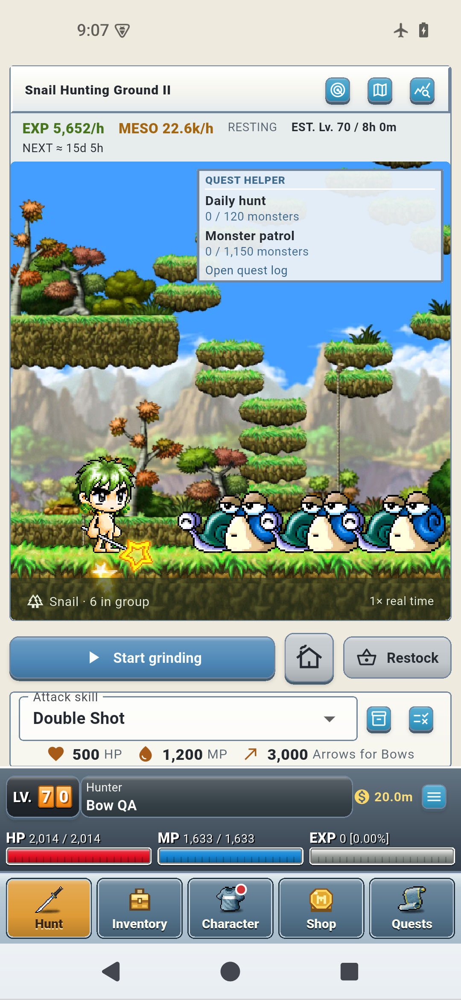
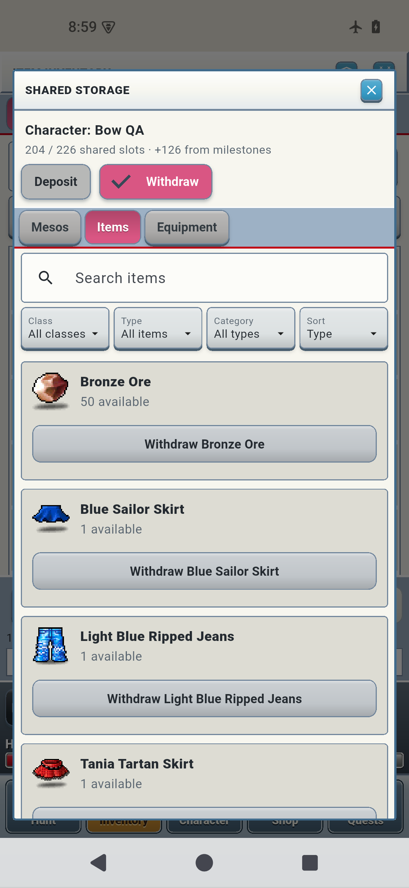
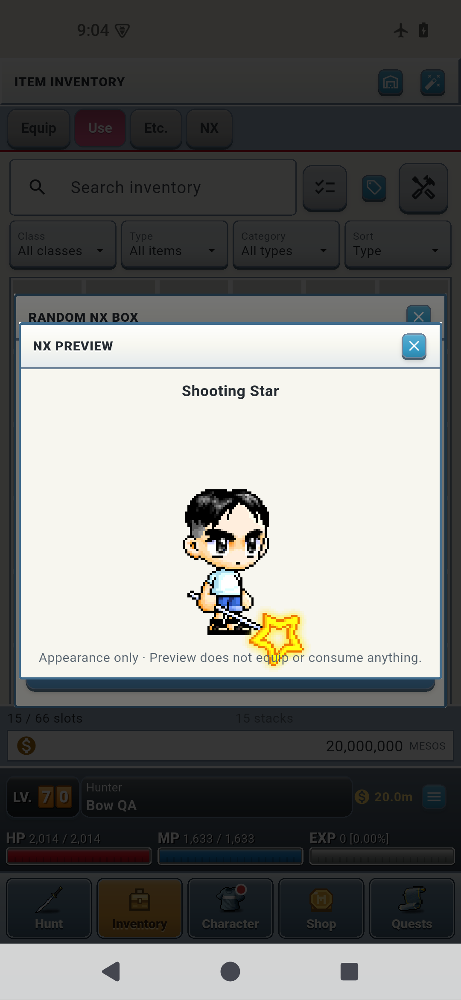

  

# RCed Idle

An offline idle RPG for **Android 8.0+**. Build your characters, hunt for equipment, develop your skills and progress while the game is closed.

[Latest update](#latest-update) · [Screenshots](#screenshots) · [Game features](#game-features) · [Install or update](#install-or-update) · [Patch history](RCed-Idle-Patch-History.md)

## Latest update

**0.21.0 — Expanded NX catalog and shared storage** · 27 October 2026

**[Download the latest APK](https://github.com/iRCed7/rced-idle-releases/releases/latest/download/RCed-Idle.apk)** · [Open the release page](https://github.com/iRCed7/rced-idle-releases/releases/latest)

- **2,090 NX appearances:** expanded clothing, accessories and compatible weapon covers join universal drops, NX boxes and boss rewards. Cosmetics keep combat stats unchanged.
- **190 hairstyles, 1,496 color variants:** preview and unlock a chosen variant permanently for each character with a hair coupon.
- **Larger shared storage:** start with 100 slots, then automatically gain six for each character's ten-level milestone through level 70. Existing levels count; three level-70 characters provide 226 slots.
- **Store directly from Inventory:** send one item, one selected stack or a multi-selection, with complete batches transferred together.
- **Easier storage browsing:** matching search, class, type, category and sort controls, plus reduced transfer work while keeping existing forecasts.
- **Lupin startup logo:** the logo appears during Android and in-game startup.
- **Clear catalog limits:** rings, chat bubbles and partner effects are excluded; seven Pirate-only weapon covers remain reserved. Upgrade each character to content 1.17 to enable the expanded rewards.

> **Updating?** Install over your existing app; do not uninstall first. Export a complete account backup from Settings. Existing characters enable new content through **Review content update → Back up & upgrade**.

Full patch notes for 0.21.0

Released 27 October 2026. App version **0.21.0**, content version **1.17.0**. Requires **Android 8.0 or later**.

### Expanded cosmetics and hairstyles

The reward catalog grows from eight cosmetics to **2,090 appearance-only equipment items and weapon covers**. It includes hats, face and eye accessories, earrings, tops, overalls, bottoms, gloves, shields, shoes, capes and **247 compatible weapon covers**.

- Universal monster drops, Random NX Boxes, guaranteed first-clear boss cosmetics and repeat-clear rare boss cosmetics all draw from the expanded eligible catalog.
- NX Boxes select uniformly from the 2,090 appearances. Duplicates remain possible; previews can be searched before opening a box.
- Hair coupons offer **190 base hairstyles across 1,496 color variants**. A coupon permanently unlocks the selected variant for that character's Styling collection.
- Cosmetic equipment changes appearance while normal gear retains its combat stats. Weapon covers use their supported weapon types and source poses; incompatible or intentionally empty source poses can hide the cover.
- Outfit artwork loads as needed, with bounded caches. Source-layer fixes include completed Red Boxing Gloves and Teddy Bear coverage.

This imports the supported physical cash equipment and hairstyles from the game's **GMS95 artwork source**. It does not include every cosmetic from every MapleStory version. **Rings, chat bubbles and partner effects are excluded.** Seven gun/knuckle-only covers remain reserved until a compatible Pirate class exists. The NX inventory pocket remains **200 slots**.

### Drop chances and boss rewards

Each defeated monster has a **1-in-60,000 cosmetic chance** and a **1-in-120,000 hair-coupon chance**. These are alternative outcomes of one global roll, not guaranteed rewards after a fixed number of kills. Enlarging the catalog does not increase the total drop chance, and Steal does not add global cosmetic rolls.

Bosses also use their separate guaranteed and rare reward rules. **Six-hour boss cooldowns, ordinary equipment drops, EXP, mesos, combat formulas and Special shop prices are unchanged.** Pending boss rewards keep their original results through the catalog upgrade. Ordinary global drops that cannot fit are skipped under the existing full-bag policy; they do not become pending boss rewards.

### Shared storage improvements

- Shared storage starts at **100 slots** and automatically gains **six slots for every ten-level milestone from 10 through 70 reached by each character**. Three level-70 characters provide **226 slots**.
- Existing levels count retroactively. Storage bonuses do not require claiming inventory milestones or upgrading a character's content pack. Mesos use no item slots.
- Send one item or selected stack directly from Inventory to storage, or transfer a multi-selection together. Selecting one stack transfers only that stack's quantity.
- A batch moves the complete selection together. If capacity or eligibility checks fail, none of its items move.
- Storage has matching search, class, type, category and sorting controls. Transfer processing preserves existing forecasts and keeps browsing available.
- Existing overflow remains stored and withdrawable. Gear keeps its rolls, scroll results, history and locks; equipped combat items and the last copy of an equipped NX appearance remain protected.

Storage responsiveness was improved and checked with batch-transfer workloads and Android interactions. These checks do not establish a specific frame rate or input latency on every phone.

### Startup and saved progress

The **Lupin logo now appears during both Android and in-game startup**. Existing characters bypass character creation and retain their progress. The save format is unchanged, and Android update, transfer, cosmetic-use and full-account restoration checks completed successfully.

The game remains fully offline. Check GitHub manually for future releases; this update does not add an automatic update checker.

## Screenshots

Android screenshots from **0.21.0**, using example characters. Select an image to view it at full size.

  
  
  

[Hunt view](media/screenshots/v0.21.0-hunt.png) · [Shared storage](media/screenshots/v0.21.0-storage.png) · [Cosmetic preview](media/screenshots/v0.21.0-cosmetic-preview.png)

## Game features

**Published game: 0.21.0 · Content: 1.17.0 · Overview dated 27 October 2026**

### Play at your own pace

- Prepare your character, choose a map, select attacks and supplies, then start grinding.
- Earn EXP, mesos and actual item drops while the game is open or closed. Offline progress runs at the same ordinary pace, with **no away-time cap**.
- Supplies, defeat, pauses and job advancement still matter. Running out of resources can stop grinding or trigger your chosen fallback; the game does not automatically buy supplies or choose your next job.
- No online account, internet connection, advertisements or real-money purchases are required to play.

### Four class families and ten second jobs

Begin as a Beginner, then develop a character through first and second job. The current catalog contains **15 jobs, including Beginner, and 94 skill definitions, including Basic Attack**.

| First job | Second-job choices |
| --- | --- |
| Warrior | Fighter, Page, Spearman |
| Bowman | Hunter, Crossbowman |
| Thief | Assassin, Bandit |
| Magician | F/P Wizard, I/L Wizard, Cleric |

Spend Ability Points and Skill Points manually, inspect each skill's requirements and effects, or save optional allocation plans for future levels. Beginner skills use their own SP pool. Job advancement always waits for your choice. Third jobs and Pirate are not included in this release.

### Shape your combat strategy

- Choose a main attack and a fallback, with minimum monster-count rules for individual skills.
- Enable optional automatic buffs, set their order, and choose whether missing resources should skip a buff or pause grinding.
- Manage HP/MP recovery choices, ammunition and rechargeable throwing stars.
- Equipment, skill ranks, attack speed, range, defense, accuracy, critical hits, multi-target attacks and supported status effects affect your results.
- Preview the estimated impact of equipment, shop purchases, skill ranks and successful scroll upgrades before committing resources.

Combat is adapted for idle play. Forecasts are estimates under stated conditions; they do not award rewards or guarantee future drops.

### Explore maps and challenge bosses

Compare training routes, view their monsters and drops, follow the live minimap, and unlock progression routes. Choose a desired farm item to help rank maps by expected yield and highlight useful finds.

Six boss encounters are available: **Mano, Stumpy, Mushmom, Shade, Zombie Mushmom and Jr. Balrog**. Victory grants EXP, mesos and equipment, with additional chances for scrolls, NX cosmetics and EXP coupons. Each boss's first clear guarantees one random NX cosmetic. Victories start a **six-hour cooldown for that boss and character**; failed attempts remain retryable. Rewards that cannot fit stay saved for later claiming.

### Collect, improve and manage equipment

- Find individually rolled equipment, check requirements, compare stats, equip upgrades and lock items you want to keep.
- Use compatible scrolls with visible success and destruction odds. View the outcome, stat changes and scrolling history.
- Browse armor progression by class, item type and search, including ordinary gear through level 70.
- Buy supplies, weapons, equipment and scrolls with mesos. Review and sell multiple inventory items together.
- Unlock **54 crafting recipes** through the level-10 milestone, including material refining and equipment crafting.
- Unlock optional **Auto-sell** through the level-40 milestone. It applies to selected future monster drops and protects farming targets and required quest items; it does not clear your existing inventory.

On current content, full bags do not stop EXP and mesos from ordinary hunting, but new item drops that cannot fit are skipped.

### Quests, milestones and the Special shop

Complete **15 active Classic quests**, plus one daily hunt and one weekly hunt. Offline kills count toward supported objectives. Follow accepted objectives on Hunt and collect rewards from the quest log.

Every ten-level milestone can be claimed for **six more slots in each ordinary inventory pocket**. Certain milestones also grant reset coupons.

The **Special shop** sells full AP/SP resets, hair coupons, random NX boxes and two-hour 2× EXP coupons for mesos. Items are purchased first and activated separately. Extra EXP coupons extend the duration at the same 2× multiplier; their timers continue while paused or offline.

### Develop a three-character account

Create up to three characters with independent jobs, equipment and grinding sessions. The second slot requires the first character to reach level 30; the third requires any character to reach level 70. Other characters can keep grinding while you play a different slot.

Shared storage starts at **100 item slots**, with **six additional slots for every ten-level milestone from 10 through 70 reached by each character**. Bonuses are automatic and retroactive, independent of inventory milestone claims and each character's content pack. Three level-70 characters provide **226 shared slots**. Mesos use no item slots, and any existing overflow remains stored and withdrawable.

Send an individual item, one selected stack or a multi-selection directly from Inventory to storage. A selected stack moves only its own quantity; a batch transfers the complete selection together or leaves it unchanged if validation fails. Storage provides matching search, class, type, category and sorting controls, with browsing available during transfers.

Shared storage transfers mesos, stackable items and unequipped gear between characters. Equipment keeps its rolls, scroll results, history and locks. Equipped combat items and the last copy of an equipped NX appearance are protected. Characters on older content may need to upgrade before receiving newer items.

### Customize your appearance

Choose a name, skin, hairstyle and face, then watch equipped gear change your character's appearance. Styling remains available after creation, with a one-time character rename.

Content 1.17 includes **2,090 reward-eligible NX equipment items and weapon covers**, including **247 compatible weapon covers**, plus **190 base hairstyles across 1,496 color variants**. NX equipment changes appearance without replacing normal combat stats. Hair coupons permanently unlock a selected variant for that character's Styling collection. The separate NX inventory pocket holds **200 slots**.

The same eligible cosmetic catalog appears in rare universal drops, Random NX Boxes and boss rewards. Boxes select equally among the 2,090 appearances, and duplicates are possible. Each defeated monster has a **1-in-60,000 cosmetic chance** and a **1-in-120,000 hair-coupon chance** as alternative global outcomes. Those are probabilities, not guaranteed rewards after that many kills. Boss-specific cosmetic rewards are separate. Ordinary drops that cannot fit are skipped; pending boss rewards retain their existing protection.

The catalog covers the supported physical cash equipment and hairstyles from the **GMS95 artwork source**, rather than every cosmetic from every region or era. **Rings, chat bubbles and partner effects are excluded**, and seven Pirate-only covers remain reserved. Weapon covers follow their supported weapon types and original pose availability; incompatible or deliberately hidden poses can leave a cover invisible. Artwork loads for requested outfits instead of loading the entire wardrobe on each screen change.

### Plan, track and stay informed

Plan supplies for **1, 4, 8 or 24 hours**, review shortages and costs, and buy a selected supply basket manually. View estimated EXP, mesos, supply costs and time to the next level. Journal tracks discoveries, while Journey records progression milestones and advancements.

Optional local notifications cover level-ups, target and rare drops, supply stops, defeat and advancement. They are off by default; delivery depends on Android's background settings. Enlarged text, reduced motion and optional workshop sound support different play preferences.

### Keep your progress

Export and import a **complete account backup** from Settings, including every character and shared storage. Existing characters retain their current content rules until you choose **Review content update → Back up & upgrade**, which settles pending time under the old rules and creates a safety backup. Upgrade each character independently to content 1.17 for the expanded cosmetic rewards. New characters start on 1.17. Storage capacity and transfer improvements apply immediately without a content upgrade.

Check GitHub manually for new releases. **Install updates over your existing app; do not uninstall first.** Export a backup before updating. The game does not automatically check for or download updates.

## Install or update

1. If you already play, export a complete account backup from **HUD menu → Settings**.
2. [Download the latest APK](https://github.com/iRCed7/rced-idle-releases/releases/latest/download/RCed-Idle.apk) and open it on your Android device. Allow your browser or file app to install it if Android asks.
3. **Install over your existing RCed Idle app. Do not uninstall first.** Uninstalling removes local game data.
4. Continue playing, or choose **Review content update → Back up & upgrade** for each character when you want its new content rules.

The game stays offline. Check the [Releases page](https://github.com/iRCed7/rced-idle-releases/releases) manually for updates. The permanent download link always serves the latest published game release.

## Guides and earlier releases

- [Complete patch history](RCed-Idle-Patch-History.md) — all recorded releases and their changes.
- [Standalone game features](RCed-Idle-Game-Features.md) — the feature guide as its own readable document.
- [Download the feature guide](https://github.com/iRCed7/rced-idle-releases/releases/download/v0.21.0/RCed-Idle-Game-Features.md) or [patch history](https://github.com/iRCed7/rced-idle-releases/releases/download/v0.21.0/RCed-Idle-Patch-History.md) as a file.
- [Browse all releases](https://github.com/iRCed7/rced-idle-releases/releases) — earlier archive entries contain patch notes only, without old game binaries. The staged 0.11.0 changes shipped in 0.12.0.

The APK's SHA-256 checksum is attached to each game release.
